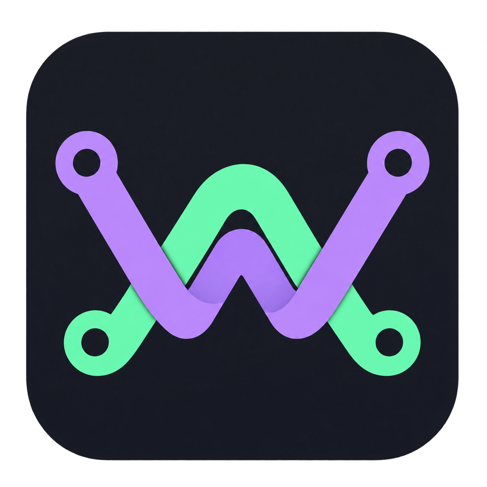

# Weave



Weave — приложение на PyQt6 для построения ML-пайплайнов из нод.
В редакторе можно подготовить CSV-данные, разделить выборку, собрать нейросеть
для классификации или регрессии, обучить её и посмотреть метрики.

## Возможности

- Нодовый редактор с типизированными портами и соединениями.
- Загрузка CSV, просмотр таблицы и описательной статистики.
- Выделение целевого столбца, удаление столбцов, бинарное кодирование
  и One-Hot Encoding.
- Разделение на Train, Validation и Test без пересечения строк.
- Сборка сети из Linear-слоёв и функций активации.
- Обучение в отдельном `QThread`, пауза, продолжение и сброс.
- Таблица метрик и графики по эпохам для каждой выборки.
- Сохранение и открытие самостоятельных проектов `.weave` на SQLite.
- Импорт и экспорт архитектуры с весами в ZIP.
- Отдельное окно Settings с выбором CPU, CUDA или ROCm.

## Установка и запуск

Проверенная среда разработки: Linux, Python 3.14.9.
Зависимости перечислены в `requirements.txt`; SQLite входит в Python.

Из корневой папки проекта:

```bash
python3 -m venv .venv
source .venv/bin/activate
python -m pip install -r requirements.txt
python main.py
```

На Windows виртуальное окружение активируется командой
`.venv\Scripts\activate`. Сборка Windows `.exe` выполняется отдельно;
готовый исполняемый файл в репозитории пока не предоставляется.

Запускайте `main.py` из корня проекта: здесь находятся `style.qss` и `assets/`.

Для ускорения на GPU нужна соответствующая сборка PyTorch и рабочий драйвер.
В Settings доступны только устройства, которые обнаружены текущей средой.
CPU доступен всегда. Приложение не устанавливает драйверы или другую сборку
PyTorch при переключении настройки.

## Работа с редактором

1. На вкладке **Node Edit** откройте контекстное меню правой кнопкой мыши
   и выберите ноду. Обработка данных находится в ветке `preprocessing`,
   модели в ветке `models`. Для поиска можно использовать поле Filter.
2. Соедините выходной порт одной ноды с совместимым входом другой.
   Порты DataFrame и Series имеют разные типы и цвета.
3. Добавьте **Dataset**, нажмите **Load Dataset** и выберите CSV.
4. Выберите ноду Dataset или Series View, чтобы увидеть данные справа:
   **Preview** показывает первые 100 строк, **Analyze** — статистику.
5. Выделенную ноду или соединение можно удалить клавишей Delete.

Основные ноды:

| Нода | Назначение |
| --- | --- |
| Dataset | Источник CSV или просмотр входящего DataFrame |
| Drop Column | Удаление выбранного столбца; Drop all NA удаляет столбцы с пропусками |
| Split Column | Отделение целевого столбца от признаков |
| Binary Replace | Для двух значений: выбранное превращается в 1, второе — в 0 |
| Train Validate Test Split | Разделение признаков и цели на согласованные выборки |
| OneHot | Кодирование категориальных признаков по категориям Train |
| Series View | Просмотр целевой переменной или другой Series |
| Classification Model | Сборка и обучение нейросети для классификации |
| Regression Model | Сборка и обучение нейросети для регрессии |

Validation включается флажком **Include validation**. Доли Test и Validation
задаются относительно исходной выборки; их сумма должна быть меньше 1.
Для дискретной цели применяется стратификация, когда для неё достаточно данных.

OneHot обучает кодировщик только на Train и применяет его к Validation/Test.
Во время изменения входных столбцов несовместимый выход временно очищается.
`min_frequency`: `0` отключает порог, число между `0` и `1` задаёт долю,
целое число от `1` — минимальное количество примеров категории.

## Пример классификации

Для `examples/dataset.csv` целевой столбец — `Claim`:

1. Подключите Dataset к Drop Column. **Drop all NA** уберёт столбец `Gender`,
   содержащий пропуски.
2. В Split Column выберите `Claim`.
3. Выход Features подключите к Features ноды Train Validate Test Split.
4. Выход Target пропустите через Binary Replace, выберите `Yes` как значение 1
   и подключите к Target ноды разбиения.
5. Три выхода Features разбиения подключите к соответствующим входам OneHot.
6. Выходы OneHot подключите к входам Features модели, а выходы Target разбиения
   — к соответствующим входам Target модели.
7. Добавьте Linear-слои и, при необходимости, функции активации.
8. На вкладке **Training** задайте параметры и нажмите **Start Training**.

Число входов первого Linear должно совпадать с числом признаков после OneHot.
Для просмотра результата OneHot можно подключить к его выходу ещё одну Dataset.
Число выходов последнего Linear должно совпадать с количеством классов,
минимум 2. Метки классов должны быть целыми числами от `0` до `C - 1`.
Последний слой выдаёт логиты; завершающий Softmax или Sigmoid
вызывает ошибку проверки архитектуры.

Для регрессии используйте числовую цель и один выход последнего Linear.
Перед обучением признаки и цель должны содержать конечные числовые значения.
Цель с пропусками блокирует разбиение; Binary Replace также отклоняет пропуски.

Ноды моделей и их карточки Training показывают одинаковый короткий ID,
полученный из UUID ноды. Он сохраняется при открытии проекта.

## Обучение и устройства

**Edit → Settings** или **Ctrl+,** открывает отдельную форму выбора устройства:

- **CPU** — расчёт на процессоре.
- **CUDA** — NVIDIA GPU с CUDA-сборкой PyTorch.
- **ROCm** — поддерживаемый AMD GPU с HIP/ROCm-сборкой PyTorch.

Недоступные варианты отключены. Выбор сохраняется через `QSettings` отдельно
от проекта и применяется к новым запускам обучения. Уже работающий или
приостановленный запуск продолжает использовать прежнее устройство.
Модель и батчи переносятся через `.to(device)`; API ROCm в PyTorch использует
имя устройства `cuda`.

- **Pause / Resume** останавливает и продолжает расчёт между батчами.
- На подтверждённой паузе доступны импорт, экспорт и **Reset Training**.
- **Reset Training** очищает историю, заново инициализирует веса и разблокирует
  редактирование архитектуры.
- Импорт заменяет архитектуру и веса только после успешной проверки архива.
- Экспорт на паузе сохраняет текущие веса и оставляет запуск на паузе.

Метрики классификации: Cross-Entropy, Accuracy, Precision, Recall и F1.
Precision, Recall и F1 используют усреднение `macro`.
Для регрессии выводятся MSE, RMSE, MAE и R². Loss рассчитывается функцией потерь
PyTorch. Таблица и графики обновляются после каждой эпохи.
На несбалансированной выборке высокая Accuracy сама по себе не означает
хорошее распознавание редкого класса.

## Проекты и модели

| Действие | Сочетание клавиш |
| --- | --- |
| Open | Ctrl+O |
| Save | Ctrl+S |
| Save As | Ctrl+Shift+S |
| Settings | Ctrl+, |

**New** очищает текущий граф после подтверждения.
При закрытии или открытии другого проекта несохранённые изменения вызывают
диалог Save / Discard / Cancel. Отмена либо ошибка сохранения оставляет
текущий проект открытым. Состояние записи отображается в статус-баре;
звёздочка в заголовке показывает несохранённые изменения.

Файл `.weave` — SQLite-база с таблицами `projects`, `datasets` и `models`.
Он содержит граф, настройки и позиции нод, исходные таблицы, архитектуры,
веса и историю метрик. Для открытия проекта исходные CSV не нужны.
Промежуточные данные пересчитываются по порядку зависимостей; текущий проект
заменяется только после успешного восстановления загружаемого файла.

После открытия можно запустить новое обучение с загруженными весами.
Состояние оптимизатора и позиция внутри батча в файл проекта не записываются.

Архив модели `.zip` содержит два файла в корне:

```text
metadata.json  — версия формата, тип задачи и список слоёв
weights.pt     — PyTorch state_dict
```

Импорт принимает только ZIP и проверяет соответствие архитектуры весам.
Тип задачи архива должен совпадать с типом ноды модели.

## Структура проекта

| Файл | Содержимое |
| --- | --- |
| `main.py` | Главное окно, меню, действия с проектом и предпросмотр |
| `FlowNodes.py` | Ноды подготовки данных и построения сетей |
| `FlowTypes.py` | Типы данных портов и типы задач |
| `FlowScene.py`, `FlowStyle.py` | Сцена редактора и её оформление |
| `Training.py` | Рабочий поток обучения и расчёт метрик |
| `TrainingUI.py` | Карточки обучения, таблицы и графики |
| `Settings.py` | Выбор устройства и сохранение настроек приложения |
| `ModelArchive.py` | Чтение и запись ZIP-архивов моделей |
| `ProjectStorage.py`, `ProjectLoader.py` | SQLite-снимки и восстановление графа |
| `MainWindow.ui`, `SettingsDialog.ui` | Формы Qt Designer |
| `ui.py`, `settings_ui.py` | Сгенерированный код форм |
| `style.qss`, `assets/` | Стиль и изображения |
| `examples/` | Примерные датасеты |
| `tests/` | Автоматические проверки |

Файлы `ui.py` и `settings_ui.py` генерируются из Designer-форм:

```bash
python -m PyQt6.uic.pyuic MainWindow.ui -o ui.py
python -m PyQt6.uic.pyuic SettingsDialog.ui -o settings_ui.py
```

Поведение окон находится в отдельных классах, чтобы повторная генерация форм
его не перезаписывала.

## Проверки для разработки

```bash
python -m pip install -r requirements-dev.txt
python -m ruff check .
python -m ruff format --check .
python -m pycodestyle .
QT_QPA_PLATFORM=offscreen python -m unittest discover -s tests -v
```

Сгенерированные формы и экспериментальная папка `testing_assets/` исключены
из проверки стиля. Рабочие модули и тесты проверяются с длиной строки 79 символов.
На Windows перед запуском тестов задайте `QT_QPA_PLATFORM=offscreen`
через переменную окружения используемой оболочки.
